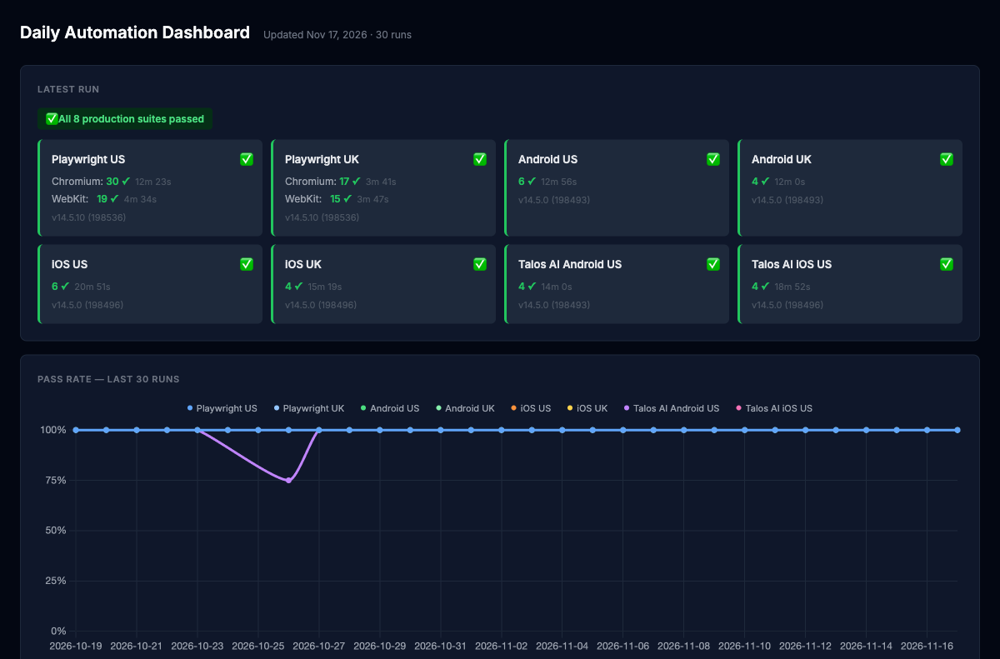

# Consumer QA Automation

> **Note:** *Talos* is a fictional company name. This repository is a sanitized copy of production QA infrastructure I built and maintained as a one-person QA team. Company name, domain, app identifiers, credentials, and internal URLs have been replaced with fictional equivalents. The architecture, test logic, and tooling are real.

[Overview](#overview) · [Tech Stack](#tech-stack) · [Structure](#structure) · [Tier Definitions](#tier-definitions) · [Playwright](#playwright) · [Maestro](#maestro) · [Talos AI Suites](#talos-ai-suites) · [CI Workflows](#ci-workflows) · [AI Digests](#ai-digests) · [Bug Report Templates](#bug-report-templates) · [MCP-Assisted Testing](#mcp-assisted-testing)

---

## Overview

This repo is the full QA automation stack for a consumer mobile and web app operating in two markets (US and UK). It covers end-to-end testing for web, iOS, and Android — running daily in CI against production builds, with results posted to Slack.

**8 daily CI suites · 3 platforms · 2 markets · designed, built, and maintained solo.**

The guiding principle is **early detection of production-impacting risk** over exhaustive coverage — favoring stability, signal, and low noise over volume.



**What's here:**

- **Playwright** — Web E2E tests in TypeScript, organized by risk tier (P1 sanity, P2 coverage), plus dedicated newbie-experience and cross-platform regression suites, with separate auth and guest contexts
- **Maestro** — Mobile UI automation for iOS and Android, covering auth, guest, newbie, deeplink, and Talos AI flows across both markets
- **AI Digests** — Two scheduled scripts that generate and post AI-written summaries to Slack: a daily PR digest that automatically flags high-risk merges for manual QA attention (scoped to what's actually verifiable by tapping through the app, so it doesn't cry wolf on unreviewable changes) and a weekly Jira bug-metrics digest
- **Dashboard** — A GitHub Pages dashboard tracking daily pass/fail trends across all eight test suites over 30 days
- **GitHub Actions** — CI workflows engineered around real self-hosted-runner constraints: separate per-platform/market pipelines (not a matrix) to avoid stale-process collisions, staggered scheduling, and a daily summary that merges partial re-runs instead of overwriting them
- **Bug report templates** — Shared templates, plus a Slack-native bug-intake shortcut, that standardize how bugs get written up and filed — by QA and non-QA staff alike
- **MCP-Assisted Testing** — Playwright and Maestro both exposed as MCP servers, letting an AI agent author and run tests conversationally

---

## Tech Stack

| Layer | Tools |
|---|---|
| Web E2E | Playwright (TypeScript) |
| Mobile E2E | Maestro |
| CI/CD | GitHub Actions (self-hosted Linux and macOS runners) |
| Reporting | GitHub Step Summaries, Slack Block Kit |
| Dashboard | GitHub Pages, Chart.js |
| AI summaries | Grok (xAI API) |
| AI-assisted authoring | Model Context Protocol (MCP) |
| Bug tracking | Jira |

---

## Structure

```
frameworks/
  playwright/
    playwright.config.ts        # Multi-project config (Desktop Chromium headless + Mobile WebKit headless for CI; headed projects for local dev)
    tests/
      setup/                    # Auth + newbie storageState generation, web build-version capture for the dashboard
      helpers/                  # Auth fixtures, cookie helpers, shared utilities
      p1-sanity/                # Critical path — failures treated as blocking
      p2-coverage/              # Broader coverage — both tiers run daily in CI
      newbie/                   # New-user experience regressions
      regressions/              # Cross-platform regressions guarding specific known defects
  maestro/
    ios/                        # iOS flows (auth + guest + newbie + deeplinks)
      subflows/                 # Reusable subflows (login US/UK/newbie, set-address, clear-bag, dismiss-home-modals)
    android/                    # Android flows (mirrors iOS structure)
      subflows/
      screenshots/              # Reference images for visual assertions
    talos-ai/
      android/                  # Talos AI Android flows (AMA, Moments, Checkout, Product Detail)
        subflows/
      ios/                      # Talos AI iOS flows (AMA, Moments, Checkout, Product Detail)
        subflows/

.github/workflows/
  playwright-web-production-us.yml         # Web E2E — US, Desktop Chromium + Mobile WebKit
  playwright-web-production-uk.yml         # Web E2E — UK, Desktop Chromium + Mobile WebKit
  maestro-android-production-us.yml        # Android — US (auth + guest + deeplinks)
  maestro-android-production-uk.yml        # Android — UK (auth + guest)
  maestro-ios-production-us.yml            # iOS — US (auth + guest + deeplinks)
  maestro-ios-production-uk.yml            # iOS — UK (auth + guest)
  maestro-talos-ai-android-production-us.yml  # Talos AI Android — US (AMA + Moments + Checkout + PDP)
  maestro-talos-ai-ios-production-us.yml      # Talos AI iOS — US (AMA + Moments + Checkout + PDP)
  daily-automation-summary.yml             # Aggregates all 8 suite results → Slack + dashboard
  pages-deploy.yml                         # Deploys docs/ to GitHub Pages
  pr-daily-digest.yml                      # Daily merged PR summary → Slack
  weekly-bug-digest.yml                    # Weekly Jira bug metrics → Slack

scripts/
  pr-daily-digest.js      # Fetches merged PRs via GitHub API, generates AI summary + regression-risk assessment
  weekly-bug-digest.js    # Fetches Jira bugs, computes metrics, generates AI insights

docs/
  index.html + trends.json  # GitHub Pages dashboard
  silenced-suites.json      # Suites/notes excluded from the dashboard's pass/fail count
  bug-templates/            # Shared qa-adhoc / qa-feature bug report templates
```

---

## Tier Definitions

**P1 — Sanity:** Fast, deterministic, stable selectors, high-signal flows, minimal marketing-copy dependency. Failures are treated as blocking.

**P2 — Coverage:** Broader user journeys, deeper UI surface validation, experiment-aware, may rely on conditional rendering.

**Regressions:** Targeted specs guarding a specific known bug or business rule, added after an incident rather than as part of tiered journey coverage. Not on the P1/P2 stability-vs-depth spectrum.

---

## Playwright

Tests are split into two risk tiers:

- **P1 Sanity** — Happy-path flows that must pass on every run: search, guest visual contract, core navigation, site health canaries.
- **P2 Coverage** — Broader scenarios: footer link integrity, guest category → PDP → availability modal, browse controls, promo surfaces.

Two focused suites sit alongside the risk tiers:

- **Newbie** — Regressions specific to the new-user experience (first-session promo banner, category rail composition), run from a dedicated newbie account with its own `storageState`.
- **Regressions** — Cross-platform specs reproducing specific production defects: the alcohol per-order ounce limit, alcohol merchant attribution on regulated PDPs, the delivery-dead-zone item conflict dialog, Contact vs Non-Contact delivery defaulting and override persistence, and a PDP carousel arrow clipped by an ancestor's `overflow-x`. Several were migrated from Maestro to web for CI stability and speed.

When a bug lives in shared, cross-platform business logic rather than platform-specific UI, the regression test targets Playwright instead of native Maestro — faster and more stable than the equivalent native flow. Regression specs run on **Desktop Chromium only** by default: since the guarded bug is defined as non-platform-specific, a second browser engine adds runtime and shared-account load without adding signal. Mobile WebKit is added only for a regression that is itself WebKit-specific.

Auth-dependent tests persist `storageState` via a global setup step so login doesn't run inside every test. Guest tests run with a clean context and no auth state. Auth specs run with `--workers=1` to prevent parallel execution against a shared account.

The UK suite uses a `/gb/` path prefix and a separate delivery address. Both markets share the same test files; market-specific config is driven by environment variables in the workflow.

Both jobs run inside the pinned official Playwright container so the WebKit OS libraries are baked in — immune to self-hosted runner image drift. The container tag is kept in sync with the `@playwright/test` version.

Each Playwright workflow (US and UK) runs both Desktop Chromium and Mobile WebKit in a single CI run across four sequential phases:

1. **Authenticated specs — Desktop Chromium** — `storageState` generated fresh each run; auth-tagged specs run on `chromium-headless`
2. **Guest suite — Desktop Chromium** — all `@auth` specs excluded; site health canary runs here only
3. **Authenticated specs — Mobile WebKit** — same auth specs run on `mobile-webkit-headless` (headless WebKit with a mobile viewport and user agent)
4. **Guest suite — Mobile WebKit** — all `@auth` and site health specs excluded

All four phases write JUnit XML reports that are parsed into the GitHub Actions run summary. Failure artifacts (screenshots, traces, and a video recording) are uploaded as downloadable artifacts and retained for 7 days.

**Visual Contract Testing:** `p1-sanity/` includes a structural visual contract spec that validates DOM/layout integrity of key guest-facing pages — home, category, deals, and search results. These are not pixel-diff snapshot tests; they assert structural correctness: presence of navigation chrome, product tile counts, bounding box sanity, and header overlap. Animations and transitions are suppressed to reduce layout jitter.

**Site Health Monitoring:** `p1-sanity/` includes site health canary specs that monitor uncaught JavaScript errors, broken or missing Next.js assets, backend 5xx responses, and GraphQL logical errors surfaced in the client.

---

## Maestro

Each platform has an auth suite (Account, Checkout, Product Detail), a consolidated guest suite, a newbie suite (fresh-account first-session checks via a dedicated `login-newbie` subflow), and a deeplinks suite (US only). Talos AI testing runs as a separate suite with its own workflows. Shared reusable subflows handle common setup — switching the active delivery address (`set-address`), emptying the bag (`clear-bag`), and dismissing home-screen promo/AI modals (`dismiss-home-modals`).

**Auth flow:** A login subflow runs once to establish session state, then each auth test runs independently from that logged-in state. UK and US use separate login subflows because the phone input and OTP entry differ between markets. After each successful login, `stopApp` leaves the app in a clean stopped state for subsequent tests.

**Guest flow:** A single consolidated flow (`ios-guest.yml` / `android-guest.yml`) launches the app clean once, sets the delivery address, then runs all guest assertions sequentially: gated/unlocked home state, address persistence on restart, browse category with sort and PDP, storefront bubble, search with results and PDP, and deals.

**Deeplinks suite (US only):** Validates custom scheme (`talos://`), Universal/App Links (`link.talos.app`), and marketing links (`ablink.noreply.talos.app`) across cold and warm start. Android handles OS disambiguation; iOS handles Universal Link routing natively.

**Checkout map assertion:** The Android checkout flow verifies the delivery map thumbnail renders by comparing against a committed reference screenshot rather than asserting on an accessibility label — the map is a rendered surface with no reliable text node.

Credentials (phone number, OTP) are injected via environment variables from GitHub secrets, never hardcoded.

---

## Talos AI Suites

Talos AI Maestro flows run as a **separate suite** from the core flows, with their own CI workflows, concurrency groups, and daily summary. This separation exists because Talos AI tests have a different flakiness profile (AI responses are non-deterministic) and a different market scope (US only).

- **AMA** — Conversational shopping: natural language add and remove, stepper interaction, and empty-bag confirmation. Requires an authenticated session pre-enrolled in the Talos AI test group.
- **Moments** — The Moments content feed: address switching across two locations and back navigation. Android also verifies PDP navigation and the CTA button ("Add to Bag" / "Notify Me"); iOS omits the PDP step — it proved unstable on CI.
- **Checkout** — Full AI-initiated order flow: natural language add, swipe-to-order, post-order survey dismiss, and order cancellation. Runs on both platforms, achieving iOS/Android parity.
- **Product Detail** — PDP regression checks reached via a natural-language product search inside Talos AI chat. Runs on both platforms.

---

## CI Workflows

### Playwright (US and UK)

Two separate workflows — one per market — each running Desktop Chromium and Mobile WebKit across four sequential phases (auth → guest → auth WebKit → guest WebKit) on a self-hosted Linux runner.

### Maestro (Android and iOS, US and UK)

**Four separate workflows** — one per platform/market combination — each following the same pattern:

1. Download the latest successful production build (APK or `.app`) from the app repo via `gh run download`
2. Boot the emulator or simulator
3. Run the test suites, writing JUnit XML reports per suite
4. Parse XML in a Python inline script to generate a GitHub Step Summary table
5. Upload failure artifacts for debugging — screenshot, view hierarchy dump, and a screen recording captured only when the suite fails (retained 7 days)

US and UK runs are staggered 30 minutes apart. **Why separate workflows instead of a matrix:** the self-hosted macOS runners are persistent machines — stale emulator/simulator processes, lingering ADB connections, and Maestro's gRPC server can persist between jobs. Parallel matrix jobs caused these to collide on the same machine. Separate workflows with a stagger give each run a clean machine state and allow independent cancellation, re-triggering, and failure attribution per market.

### Talos AI (Android and iOS, US only)

Two separate workflows — Android and iOS — staggered 30 minutes apart. All four Talos AI suites (AMA, Moments, Checkout, Product Detail) run on each platform's daily schedule; `workflow_dispatch` inputs allow running a subset manually.

### Daily Automation Summary

A separate daily workflow that runs after all test suites complete. Downloads `daily-results.json` artifacts from all eight workflows (Playwright US/UK, Android US/UK, iOS US/UK, Talos AI Android/iOS), writes to `docs/trends.json` to update the GitHub Pages dashboard, and posts to Slack — a version breadcrumb (web, Android, iOS build versions) followed by **exceptions only**: failing or unavailable suites, with a separate "Known issues" line for anything deliberately silenced (see below). A quiet morning preview run posts the same summary to a DM a few hours before the real end-of-day send, so issues surface earlier without doubling the noise in the shared channel.

When a suite is re-run later the same day (e.g. a `workflow_dispatch` retry of just the suite that failed), the summary merges that day's runs per-suite rather than only reading the latest one — a later run's numbers win for the suite it covers, so a partial rerun patches in a fix without the dashboard losing results for suites it didn't touch.

**Silencing a suite:** `docs/silenced-suites.json` lists suites to exclude from the pass/fail count and alerting — for a suite failing on a known infra/build-pipeline issue that isn't an app regression. A silenced suite still shows up, just as a separate "Known issues" line instead of a failure, and the entry is meant to be removed once the underlying issue is fixed.

---

## AI Digests

### PR Daily Digest

Runs every morning. Fetches all PRs merged to `dev` the previous calendar day (ET) via the GitHub API, classifies touched areas by file path (iOS, Android, Checkout, Auth, etc.), and generates a plain-prose AI summary of what shipped, with Jira links per PR.

PRs touching high-risk consumer-facing areas — **Auth**, **Checkout**, **Navigation**, and **UI** (design system / theming / component changes) — additionally get an AI **UI Regression Risk** assessment flagging them for manual QA attention. The risk gate is scoped to buckets that are actually verifiable by tapping through the app; **State** and **API/Networking** changes were dropped from the gate because they can't reliably be confirmed that way. Infra-only and internal-tooling changes are filtered out before evaluation, and each candidate is flagged only if the change is substantive and verifiable by tapping through the app UI — changes checkable only via network or backend inspection are excluded — with the assessment specifying exactly what to verify. Checkout and Auth use a baseline substantive-change bar; Navigation/UI-only PRs must additionally risk breaking an existing flow or touch a highly visible surface, keeping cosmetic or low-traffic changes out of the queue. Each flagged PR is also tagged with its inferred platform (Web / Native / Cross-platform / "Shared code" for RN source with no platform-specific file suffix) based on `.web.`/`.ios.`/`.android.`/`.native.` filename suffixes. The queue is scoped to the Consumer Experience product team (other teams own their own QA) and PRs already marked QA complete in Jira are dropped rather than just flagged. Posts to a Slack channel and optionally a DM.

### Weekly Bug Digest

Runs every Monday. Queries Jira for the open bug backlog (`project = TALOS AND issuetype = Bug`), scoped to the Consumer Quality, Consumer Experience, and Loyalty product teams. Computes priority breakdown, status distribution, filing and closure rates across 4 weeks (current week + prior 3), unassigned count, stale in-progress bugs, bugs older than 1 year, ad hoc bug filed/closed counts with median time-to-fix, and top bug squashers. Generates an AI trend summary, then posts a structured Slack Block Kit message with deep-link JQL URLs for every metric.

---

## Bug Report Templates

`docs/bug-templates/` holds two shared templates that standardize how bugs get written up before filing:

- **qa-adhoc** — bugs found during ad hoc or exploratory testing and regression sweeps, not tied to a feature branch
- **qa-feature** — bugs found while testing a feature branch, user story, or design spec

Both fix the report layout (environment, path, steps, actual/expected results, attachments) and the prose conventions that keep reports consistent and searchable — how UI text is quoted, when title case applies, and how platforms are named. They also back a Slack bug-intake shortcut that lets non-QA staff file a bug straight from a Slack thread: the report is drafted from the thread's text and images, posted back to the thread for review and editing, and filed in Jira only after a human approves it in a review modal. That intake service lives in its own repository and is not part of this repo.

---

## MCP-Assisted Testing

Both Playwright and Maestro expose an MCP server, letting an AI agent drive tests conversationally — authoring flows, inspecting live UI state, and running specs without leaving the chat:

```bash
claude mcp add playwright -- npx -y @playwright/mcp@latest
claude mcp add maestro -- maestro mcp
```

**Playwright MCP** drives a real browser — navigate, click, fill forms, take snapshots, read console and network activity. Useful for reproducing a bug interactively or validating a fix before writing a spec.

**Maestro MCP** authors and runs declarative YAML flows against Android emulators, iOS simulators, or Chromium — `list_devices` → `inspect_screen` → `run` — and can dispatch to Maestro Cloud.

This is a local exploration and authoring aid, not a replacement for the checked-in specs in `frameworks/` or the CI suites.
